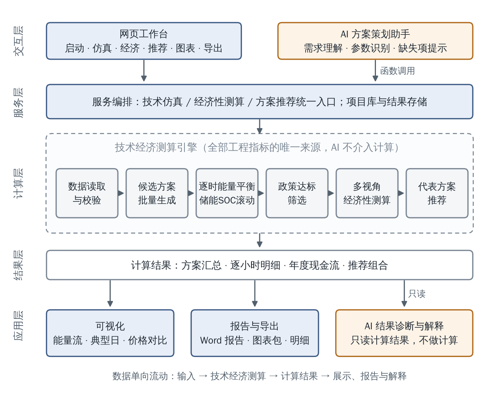
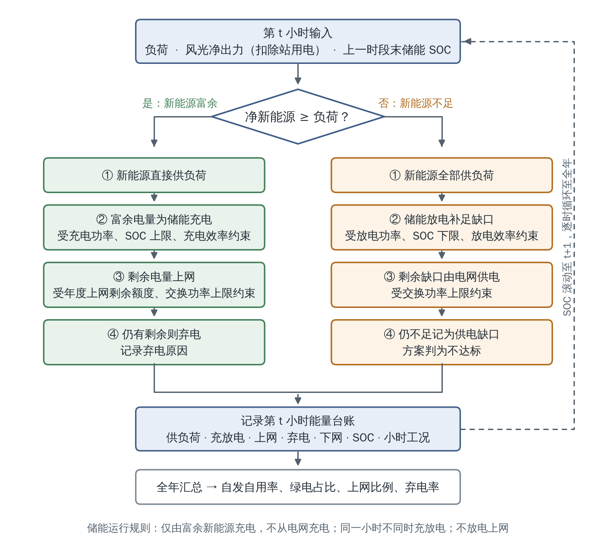
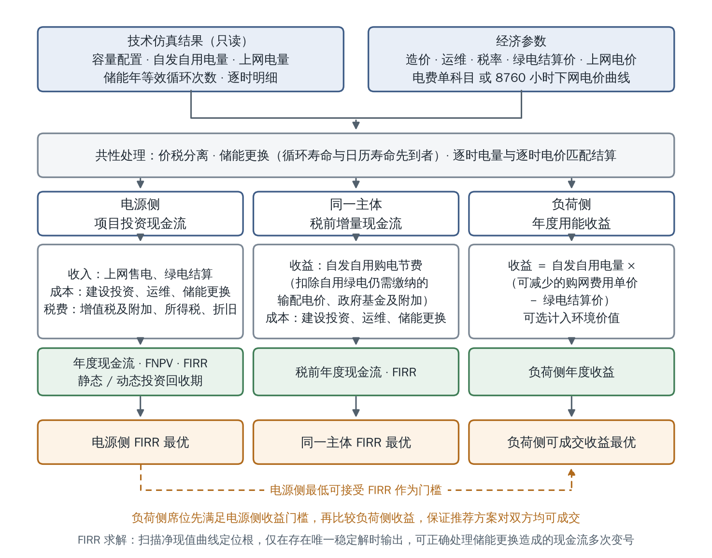
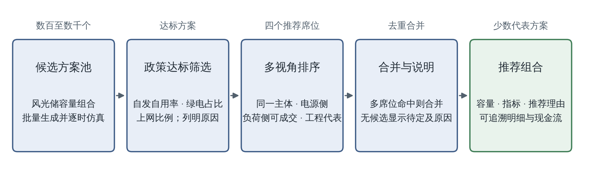
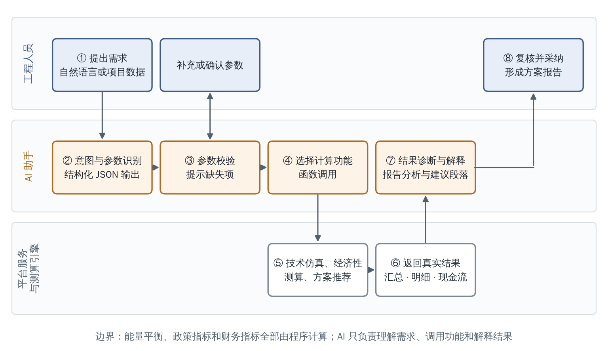

> **说明（2026-10-30 更新）**
> 1. 本文为《绿电直连项目AI辅助策划平台-项目成果报告》的同步文本，基于项目组修订版并补充附图、调整核心技术点表述；Word 版另行交付，不入库。
> 2. 人员姓名、联系方式和应用项目清单不写入本仓库。
> 3. 附图源程序见 `figs_source.py`；图5 为平台界面截图。

# 绿电直连项目AI辅助策划平台项目成果报告

### 一、项目基本信息

| **项目名称** | 绿电直连项目AI辅助策划平台 | **申报部门** | 【待填】      |
|--------------|----------------------------|--------------|---------------|
| 项目状态     | □ 已完成 ☑ 阶段性成果      | 起止时间     | 2026年5月至今 |
| 负责人       | （见 Word 版）                     | 联系电话     | 【待填】      |

### 二、项目背景与目标

（一）项目立项背景（业务痛点、需求来源）

2025年5月，国家发展改革委、国家能源局印发《关于有序推动绿电直连发展有关事项的通知》（发改能源〔2025〕650号）；2026年5月，两部门印发《关于有序推动多用户绿电直连发展有关事项的通知》（发改能源〔2026〕688号），将绿电直连由单一用户扩展至多个法人用户，并对项目规划提出量化要求：年自发自用电量占总可用发电量的比例不低于60%，占总用电量的比例不低于30%、2030年前不低于35%；并网型项目年上网电量原则上不超过总可用发电量的20%；项目主责单位可由电源方与负荷方合资组建，也可由一方单独投资组建。绿电直连项目由此成为新能源项目前期咨询、方案编制和投标工作中快速增长的新兴业务。

1.项目团队在承担此类项目前期工作时，有<u>三个核心问题</u>：

（1）风电、光伏、储能如何配置；

（2）配置方案能否满足政策指标；

（3）在不同投资主体结构下，各方经济性是否可以接受。

2.现有工作方式难以快速可靠回答上述问题，<u>主要痛点</u>如下：

（1）逐时耦合计算复杂。方案测算须在全年8760小时上逐时完成新能源出力、用户负荷与储能充放电的能量平衡，并滚动计算储能荷电状态，同时满足充放电功率、容量、效率和荷电状态上下限等约束。以电子表格人工搭建，耗时长且易出错。

（2）方案覆盖面不足。风电、光伏、储能容量组合构成多维搜索空间，人工只能试算少数方案，难以圈定可行配置区间，也难以系统找出既满足政策要求又具备经济性的代表方案。

（3）多主体利益难以兼顾。同一配置方案对电源投资方、用电企业以及同一投资主体的收益并不一致。前期缺少分别站在各方立场测算并比较的工具，多方沟通成本高，达成共识慢。

（4）测算结果理解成本高。能量流向、典型日运行方式、直连前后到户电价与用能成本变化等关键信息，以数字表格呈现不够直观，方案评审中解释和返工较多。

受上述因素影响，单个项目从数据整理到形成方案比选结果，通常<u>不少于5个工作日</u>。

（二）项目建设目标（预期解决的问题、预期成效）

项目以绿电直连及源网荷储项目前期策划为应用场景，建设一套以逐时多方案调度仿真+经济性评价为基础、以可视化和AI助手为辅助的方案策划平台。

**1.预期解决的问题。**一是在全年逐小时尺度上完成风光储容量方案的批量测算，快速圈定可行配置区间；二是将政策指标内置于方案筛选过程，自动判定达标情况并列明原因；三是按电源侧、负荷侧和同一投资主体等不同视角测算经济性，并分别推荐代表方案；四是以可视化图表、结构化报告和AI解释降低测算结果的理解与沟通成本。

**2.预期成效。**单个项目取得初步测算结果的时间由不少于5个工作日<u>缩短至约1个工作日</u>；可比选方案数量由个位数扩大至数千个；测算报告由人工整理改为平台自动生成，可直接<u>用于项目申报、实施方案、预可研</u>。

### 三、技术方案

（一）总体技术架构

平台采用“技术经济测算在下、AI辅助在上”的分层架构（图1）。全部工程指标由技术经济测算引擎计算；AI方案策划助手通过服务层入口调用计算功能，并只读取计算结果进行诊断与解释，不参与工程计算。数据按“输入—计算—结果—展示与解释”的方向单向流动。

**图1 总体技术架构**

**表1 各层组成与职责**

| 层次   | 组成                                                             | 主要职责                                                                                     |
|--------|------------------------------------------------------------------|----------------------------------------------------------------------------------------------|
| 交互层 | 网页工作台、AI助手                                               | 按项目前期工作顺序组织操作；以自然语言接收需求，识别参数并提示缺失项                         |
| 服务层 | 服务编排、项目库与结果存储                                       | 为工作台和AI助手提供统一的技术仿真、经济性测算和方案推荐入口；保存输入、配置、结果和交付成果 |
| 计算层 | 数据读取校验、方案生成、逐时仿真、政策筛选、经济性测算、方案推荐 | 计算全部工程指标，是工程结论的唯一来源                                                       |
| 结果层 | 方案汇总、逐小时明细、年度现金流、推荐组合                       | 以方案编号相互关联，供下游模块只读使用                                                       |
| 应用层 | 可视化、报告与导出、AI结果解释                                   | 读取计算结果进行展示、成文和解释，不重新计算                                                 |

网页工作台按项目前期工作顺序设置项目启动、方案仿真、经济性测算、方案推荐、图表概览、报告导出等功能页面，用户可在浏览器中完成从数据上传到报告输出的全部操作。

（二）核心技术点与AI技术应用情况

**1.逐时能量台账与约束调度。**为每个候选方案建立全年逐时能量台账，逐时记录风光出力、站用电、供负荷电量、储能充放电、上网、弃电、下网电量和储能荷电状态，年度指标均由台账汇总得到，可逐小时复核。调度采用规则化策略（图2）：新能源优先供应负荷，富余电量优先为储能充电，其余按上网规则上网或弃电；新能源不足时储能放电，仍不足部分由电网供应。储能仅由富余新能源充电，不从电网充电，同一小时内不同时充放电，不放电上网，充放电受功率、容量、效率和荷电状态上下限约束。年度上网比例在运行过程中按剩余额度滚动控制，额度用尽后富余电量转为弃电，属于过程约束而非事后校核；与电网交换功率限制同时约束上网和下网功率。风光出力中的负值按电源站用电计入能量平衡。

**图2 逐时能量平衡与储能调度流程**

**2.政策指标嵌入式筛选与归因诊断。**自发自用率、绿电占比、上网比例、弃电率、下网电量比例和储能年等效循环次数等指标由逐时台账聚合计算，政策门槛按国家政策文件和省级细则参数化设置。方案不达标时逐项列明未满足的指标，筛选结果作为经济性比选和方案推荐的前置条件。

**3.多主体现金流模型与稳健收益率求解。**经济性测算只读取技术仿真结果，不改变调度结果，按三个视角分别建模（图3）：电源侧按项目投资现金流口径，计入建设投资、上网售电和绿电结算收入、运维成本、增值税及附加、企业所得税、折旧和储能更换，输出年度现金流、财务净现值、财务内部收益率和静态、动态投资回收期；同一主体将自发自用电量形成的购电节费计入收益，计算税前现金流和财务内部收益率；负荷侧以自发自用电量乘以可减少的购网费用单价与绿电结算价之差，计算年度收益。储能更换年份取循环寿命与日历寿命先到者，其中循环寿命按技术仿真得到的年等效循环次数折算为年限。储能更换会使运营期现金流多次变号，存在多重内部收益率的风险；平台先扫描净现值曲线定位全部根，仅在存在唯一稳定解时输出财务内部收益率，否则标注为无法可靠计算。

**图3 多视角经济性测算框架**

**4.电费单科目逆推与逐时电价结算。**用户按电费单填写到户综合电价及线损费、系统运行费、输配电价、政府性基金及附加等科目，平台逆推电能量价格，区分自用绿电仍需缴纳和可以节省的费用，分别得出同一主体购电节费单价和负荷侧可减少购网费用单价，并进行价税分离。上传全年逐时下网电价曲线时，按逐时自发自用电量与逐时电价匹配结算，反映分时电价对经济性的影响。

**5.可成交约束下的多席位推荐。**推荐引擎先筛选政策达标方案，再按同一主体、电源侧、负荷侧和工程代表四个席位分别排序（图4、表3）。负荷侧席位先以电源侧最低可接受财务内部收益率过滤候选方案，再比较负荷侧收益，保证推荐方案对电源方和负荷方均具备可成交性。同一方案命中多个席位时合并展示；席位无候选时显示待定状态及原因。

**图4 代表方案推荐流程**

**6.可视化与报告。**提供能量流向图、典型日运行曲线（图5）、直连前后到户电价与用能成本对比、推荐方案三维经济性对比图等视图；可导出方案汇总、逐小时明细、年度现金流、交互式图表包、适用于Word排版的图表包和Word格式测算报告。

（图5 为平台界面截图，见 Word 版）

**图5 平台典型日运行视图（示例数据）**

**7.汇总优先、按需重算的批量计算架构。**批量计算阶段仅保留方案汇总；平台留存输入曲线和参数配置快照，推荐方案或用户选定方案需要出图、出报告或复核时，按方案编号重新计算其全年逐时明细，结果可复现，同时控制内存和存储占用。调度计算采用数组化热点路径和多进程并行，并在计算前预估耗时；项目库保存输入、配置、计算结果和交付成果，支持跨会话恢复。在测试环境中，1785个方案的全年逐时仿真单进程约10.5秒、4进程并行约3.2秒完成，相应经济性测算约0.4秒。

**8.AI技术应用情况。**AI方案策划助手构建在服务层之上（图6），调用国产大模型，采用结构化JSON输出与函数调用机制，承担以下工作：理解工程人员的自然语言需求；识别、校验输入参数并提示缺失项；选择并调用平台的技术仿真、经济性测算和方案推荐功能；读取并比较真实计算结果，诊断方案差异，生成有计算依据的解释和建议；参与撰写技术经济分析报告数据分析和结论建议部分内容。

**图6 AI方案策划助手工作流程**

**表2 AI职责边界**

| AI参与                             | AI不参与                                   |
|------------------------------------|--------------------------------------------|
| 理解自然语言需求，识别与校验参数   | 逐时能量平衡与储能荷电状态计算             |
| 选择并调用平台计算功能             | 自发自用率、绿电占比、弃电率等政策指标计算 |
| 读取、比较真实计算结果             | 财务净现值、财务内部收益率、投资回收期计算 |
| 撰写报告中的数据分析与结论建议段落 | 修改计算结果或自行生成工程数据             |
| 诊断方案差异，生成解释与建议       | 决定“是否达标、收益多少”的任何工程指标     |

上述边界将大模型输出的不确定性限定在需求理解与结果解释环节，不影响工程指标的正确性和可复核性。

在研发过程中，项目团队以业务人员为主导，采用AI辅助编程完成需求梳理、代码编写、测试编写和代码评审等工作，并以开发规则文件、自动化测试和决策记录对AI生成内容进行约束和校核。

（三）技术创新点

**1.聚焦绿电直连咨询业务主要矛盾。**同类工具多以容量优化求解或电价预测下的调度优化为方向，而绿电直连项目周边新能源资源有限、可选配置空间不大，电价预测又高度依赖基础数据，优化求解的假设在工程中容易失真。本平台在保证容量配置和逐时调度可靠的前提下，将研发重心集中于多视角经济性比选和测算结果理解两个影响项目推进的关键环节。

**2.多视角利益校准的方案推荐。**针对688号文允许电源方与负荷方合资或单方投资的规定，平台设置四个推荐席位（表3），在政策达标的共同前提下分别给出对各方最优的方案。负荷侧席位以电源侧最低可接受收益率为门槛，避免推荐对电源方不具备可行性的方案，使比选结果可用于多方协商。

**表3 推荐席位设置**

| 推荐席位             | 适用情形                   | 排序依据                                                           |
|----------------------|----------------------------|--------------------------------------------------------------------|
| 同一主体FIRR最优     | 电源与负荷由同一主体投资   | 计入购电节费的税前财务内部收益率                                   |
| 电源侧FIRR最优       | 电源方独立投资             | 电源侧项目投资财务内部收益率                                       |
| 负荷侧可成交收益最优 | 电源方与负荷方分属不同主体 | 电源侧收益率不低于设定门槛前提下的负荷侧收益                       |
| 工程代表方案         | 技术比选与汇报             | 默认取达标方案中投资最小者，可切换为低弃电、高绿电占比、高自发自用 |

**3.“技术经济测算＋AI辅助决策”的人机协同架构。**明确划分程序计算与AI的职责边界：工程指标全部由技术经济测算引擎计算，AI仅承担需求理解、功能调用和结果解释。在发挥大模型交互能力的同时，保证工程结论可信、可复核。

**4.可追溯的计算结果链与可视化表达。**技术仿真结果是唯一事实来源，政策评估、经济性测算、推荐、图表、报告和AI解释均只读取该结果，并以方案编号关联，每个推荐结论均可追溯至全年逐小时明细和逐年现金流。在此基础上，以能量流向、典型日运行和直连前后电价对比等视图，将数千个方案、全年逐时的测算结果转化为各方易于理解的沟通材料。

**5.贴合国内电价构成的经济性输入。**经济性参数按电费单科目组织，用户填写到户综合电价、线损费、系统运行费、输配电价、政府性基金及附加等账单项，平台内部推导各视角节费；默认值按湖南110kV工商业两部制用户电费构成预置，并支持上传8760小时下网电价曲线，降低经济性测算的使用门槛。

### 四、实施进展与成果

（一）项目实施进度与完成情况

项目于2026年5月启动，采用分阶段迭代方式实施，各阶段完成情况见表4。

**表4 项目实施进度**

| 阶段           | 时间                   | 主要内容                                                                 | 完成情况 |
|----------------|------------------------|--------------------------------------------------------------------------|----------|
| 测算内核       | 2026年5月中旬          | 曲线读取与校验、逐时风光储仿真、批量方案测算、政策指标、结果导出         | 已完成   |
| 定位调整       | 2026年5月中旬          | 对标同类软件，确定由批量测算工具转为方案策划与推荐平台，编制专家审查材料 | 已完成   |
| 经济性与推荐   | 2026年5月下旬          | 三视角经济性测算、四席位方案推荐                                         | 已完成   |
| 工作台与可视化 | 2026年6月              | 网页工作台、图表模块、8760小时电价曲线、项目与结果管理、性能优化         | 已完成   |
| 报告与项目库   | 2026年6月下旬至7月上旬 | Word测算报告、本地项目库、电费单式经济性输入                             | 已完成   |
| 项目试用       | 【2026年7月至今】      | 在70余个项目中试用，并根据反馈持续修正                                   | 持续进行 |
| AI方案策划助手 | 【待确认】             | 需求理解、参数识别、功能调用、结果解释                                   | 持续优化 |

目前，平台已完成数据接入、逐时仿真、政策评估、经济性测算、方案推荐、可视化与报告等核心功能，建立了455项自动化测试，覆盖储能调度约束、指标计算、经济性测算、推荐排序、电价曲线和结果存储等内容；AI方案策划助手已实现主体功能，正在持续优化。

后续工作包括：结合项目应用反馈完善计算口径和输入方式；纳入柴油发电机组，支持离网、并网加备用等运行模式；推进服务器部署和多用户使用。

（二）试运行/落地应用情况

平台已在70余个绿电直连、源网荷储项目中投入试用。

（项目清单见 Word 版，不入库。）

### 五、应用成效

（一）业务问题解决情况

**表5 业务问题解决情况**

| **业务痛点**       | **解决方式**                                       | **效果**                                     |
|--------------------|----------------------------------------------------|----------------------------------------------|
| 逐时耦合计算复杂   | 程序化逐时仿真与储能调度，核心口径以自动化测试固化 | 测算由人工搭表转为自动计算，结果可逐小时复核 |
| 方案覆盖面不足     | 批量生成并测算数百至数千个方案，政策指标自动筛选   | 一次圈定可行配置区间                         |
| 多主体利益难以兼顾 | 四个推荐席位分别给出各方最优方案                   | 各方在同一组达标方案上比较各自收益           |
| 测算结果理解成本高 | 可视化视图、Word测算报告、AI结果解释               | 技术经济评价报告由平台直接生成               |

（二）效率提升、成本节约等量化成效

**1.测算周期缩短约80%。**单个项目达到平台现有成果深度，传统方式耗时不少于5个工作日；使用平台后，完成数据处理并取得初步结果约需1个工作日。

**2.方案覆盖面扩大至数千个。**人工方式一般仅能试算个位数方案；平台单次可测算数千个方案。在测试环境中，1785个方案的全年逐时仿真单进程约10.5秒、4进程并行约3.2秒完成。

**3.累计节约前期工作量约280个工作日。**按每个项目节约不少于4个工作日估算，70余个项目累计节约前期测算工作量约280个工作日。

**4.运行成本低。**平台对硬件要求低，AI助手调用国产大模型服务，仅产生少量调用费用。

### 六、其他说明

平台应用演示PPT材料另附。【待补】
